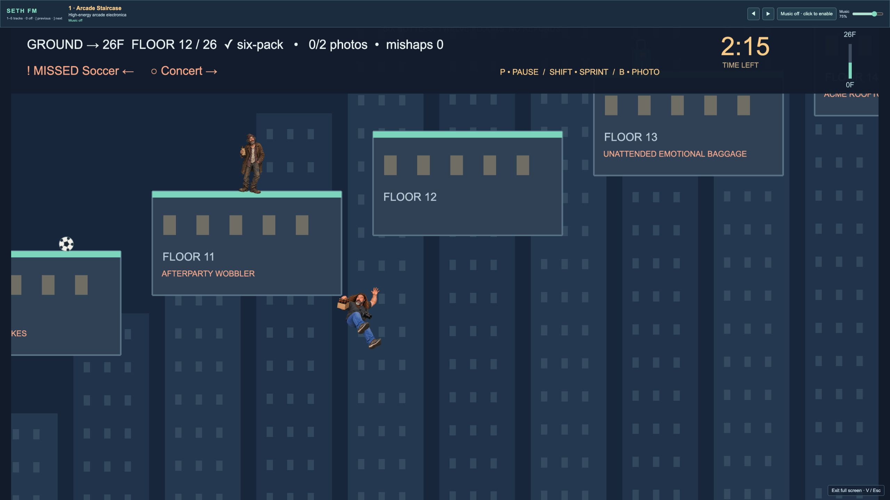
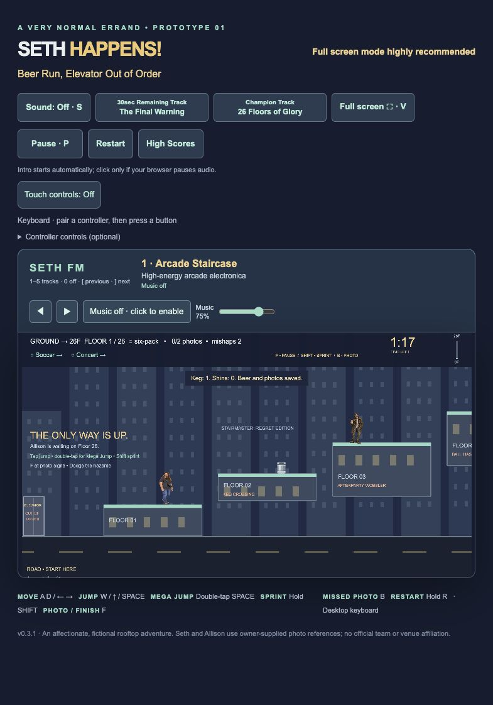
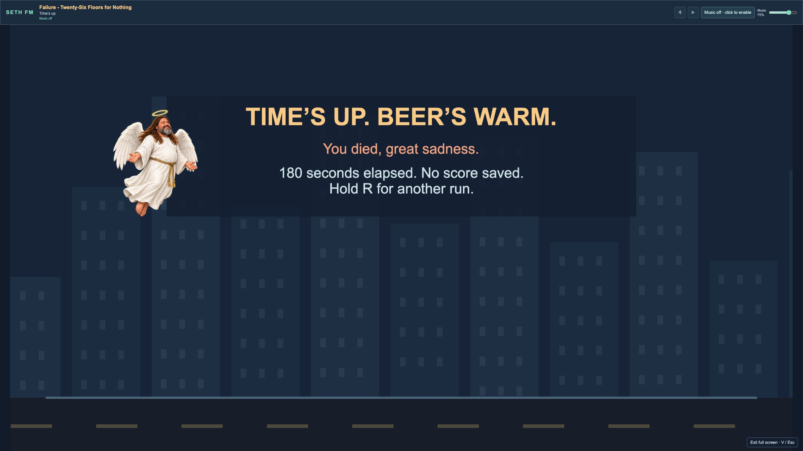

# Seth Happens - Beer Run, Elevator Out of Order

**Version 0.3.1**


<p align="center">
  <a href="https://natsteff.github.io/seth-happens/"></a>
</p>

**Play version 0.3.1** — Fullscreen highly recommended. **Play Now on GitHub Pages uses local browser high scores only. Server-wide high scores cannot run on GitHub Pages; they require a server-enabled installation.**

One six-pack. Two photos. Twenty-six floors. Get Seth home to Allison, Oakey and Ellowyn before the three-minute deadline. See if you can find the 'easter egg'!

🎵 **[Listen to the entire video game soundtrack](https://suno.com/playlist/0ef61d61-9481-48f2-b67f-989cffdc9cca)**.

## Fun Things to Explore

- **GO FULL SCREEN!** Bigger Seth, bigger jumps, bigger questionable decisions.
- Find the **easter egg cheat**—see if you can discover it yourself!
- Experiment with the **radio stations and tracks**.
- Try different **30-second warning** and **Champion Track** selections.
- **Don’t fall…or do, because it’s hilarious.**
- **Let time run out and see what happens.**

## Controls

| Action | Key |
| --- | --- |
| Move | A / D or ← / → |
| Jump | Space, W or ↑ jumps immediately; press twice within 0.3s for Mega Jump. Holding has no extra effect |
| Sprint | Hold Shift |
| Optional controller | Left stick/D-pad move; A/Cross jump (double-press Mega Jump); RT/R2 sprint; X/Square interact; B/Circle recall; Menu/Options pause |
| Pause / resume | P or Pause button |
| Photo / finish | F |
| Return to a missed photo | B |
| Sound | S |
| Fullscreen | V or fullscreen button; Esc exits |
| Restart | Hold R |

Floor 01 is the first rooftop. Returning to a lower rooftop is safe. Missing the rooftops and falling toward the road from Floor 02 or higher screams, costs one fall penalty, and retries the last rooftop. Dropping from Floor 01 to the road remains safe.

Keyboard remains the default and stays active with a controller connected. Pair a supported standard-layout controller through the operating system, focus the game and press a button; release controls to neutral before play. Disconnecting the active controller pauses play. Use keyboard/mouse for menus, restarting and high-score name entry. Actual device/browser compatibility still needs hardware testing.

Rolling and walking obstacles patrol the whole floor. Pianos, anvils, window AC units and beer coolers drop at distinct intervals in the middle of their platforms. Watch their warning and aftermath, then choose your jump. Falling objects can squish you during descent; once landed they are safe to touch but solid, so jump over them.

## Music radio

Five backing tracks are selectable in the SETH FM bar. **Arcade Staircase** is default; keys **1–5** select songs, **0** turns music off, and **[ previous · ] next** select previous/next with wraparound. New players start at **75%** music volume; preferences persist between sessions. The music slider reaches silence without changing voices/effects. **S** mutes all sound. Gameplay songs loop and pause with play/score dialogs. At run end, outcome music replaces them; completion music continues through score entry. Music starts after the intro and appears in fullscreen too.

## Scoring and records

- Finish within **180 seconds**: 1,000 base points.
- Each photo: +250; photos first recovered after reaching floor 26: +125.
- Deliver the six-pack: +500.
- Each fall, squish or bump: −10, counting each incident once.
- Finish under **120 seconds**: +100 for each whole second saved. A 90-second finish earns +3,000. Fractional seconds round up before calculating the bonus.
- At 180 seconds, the run fails and no score is saved.
- Intro and high-score dialogs pause the clock. P pauses gameplay, countdown, animations and audio. Resume continues from the same point.

## Optional server high scores

High Scores opens your existing local browser list directly by default, including on the **Play Now** GitHub Pages version. Server scores default off in `public/game-config.json` (deployed as `game-config.json`).

Server installations can enable **Server High Scores** alongside **This PC High Scores**. New runs attempt both lists, with separate save results. Existing local records automatically sync to that deployment’s server when enabled, without deleting local scores or duplicating imports. Failed syncs retry when reopening scores or reconnecting. Older untimed runs retain their original score and date without an invented timer bonus. Each hosted copy has its own shared records.

Server-wide scores require a running score service; GitHub Pages cannot provide it. See [server setup](docs/leaderboard-server.md). Clearing acts on the selected list only and requires its password and confirmation.


## Screenshots

Desktop captures from version 0.3.1. Game shots use 2560×1440 fullscreen (16:9); settings are shown in the normal desktop view.







## Local development

Node 22.13+ and pnpm 11.25.0:

```sh
pnpm install
pnpm dev
pnpm test
pnpm build
```

The repository uses relative asset URLs for GitHub Pages. Source is on main; the compiled playable site is on gh-pages. The shared leaderboard requires the server setup above; GitHub Pages hosts only the game files. No player accounts or analytics.

Owner-supplied character references, logo and audio; generated character artwork and original code-drawn props/effects. The Minnesota United crest is owner supplied for an unofficial fan scene; no affiliation or endorsement. Raw reference photographs are not included. See [asset and dependency notices](THIRD_PARTY_NOTICES.md).

## Final-warning and champion music

The **30sec Remaining Track** selector offers **The Final Warning** (default) and **System Failure Imminent**. At30 seconds remaining, gameplay music crossfades into your selected warning track over **1.25 seconds**; the radio turns red and station switching locks.

**Champion Track** selects **26 Floors of Glory** (default) or **Eye of the Stairwell**. It loops after successful completion and through high-score entry. Timeout has a separate looping failure track. Music volume/mute still apply, and effects play over the music.

Gameplay station, warning/champion selections, music volume, music on/off and overall sound are remembered in this browser. A saved volume overrides the **75%** first-visit default. Clearing site data removes preferences.

## Music, sound and voice credits

- Music created by **[BT-AI](https://suno.com/@bt_ai)**.
- Select sound effects from **[Pixabay](https://pixabay.com/sound-effects/)**, alongside original synthesized game effects.
- Voices built using **[ElevenLabs](https://elevenlabs.io/)**.

🎵 **[Listen to the entire video game soundtrack](https://suno.com/playlist/0ef61d61-9481-48f2-b67f-989cffdc9cca)**.

## What’s new in 0.3.1

- Optional mobile touch D-pad, Jump/Action, Sprint, Recall, Pause and held Restart.
- Fullscreen touch settings and expanded view for browsers without fullscreen.
- Held-touch cleanup on cancellation, app switching, rotation and score dialogs.

## What’s new in 0.3.0

- Five-track SETH FM radio with saved preferences, independent volume, warning-track crossfade and selectable completion music.
- Optional standard-layout gamepad support alongside keyboard controls (physical controller acceptance still pending).
- Updated walking/falling/carrying sprites, faster sprint cadence, earlier fall audio and solid landed hazards.
- Richer timeout presentation, clearer controls/layout and removal of the old jump-clue toggle.
- Existing browser high scores remain preserved; Play Now still uses local-only scores.

### Mobile touch controls

Touch-capable devices are offered optional touch controls. You can also use the **Touch controls** button. Landscape is recommended. Enable touch controls to request fullscreen from your tap; browsers without fullscreen use an expanded view instead. **Expand / Exit** returns to the page.

Use the left/right D-pad to move, **Jump** to hop (double-tap within 300ms for Mega Jump), **Action** for photos/finish/elevator, and hold **Sprint** while moving. **Recall photo**, **Pause / Resume**, and **Hold Restart** (0.65 seconds) are also available. Touch controls support multiple fingers and release held actions on cancellation, lost focus, resizing or score dialogs. Keyboard and standard controllers remain available. Physical iOS/Android acceptance is pending. Landscape is the recommended way to play on a phone. Open **Settings / Scores** inside the touch deck for sound, outcome tracks and high scores; the radio provides music controls.
