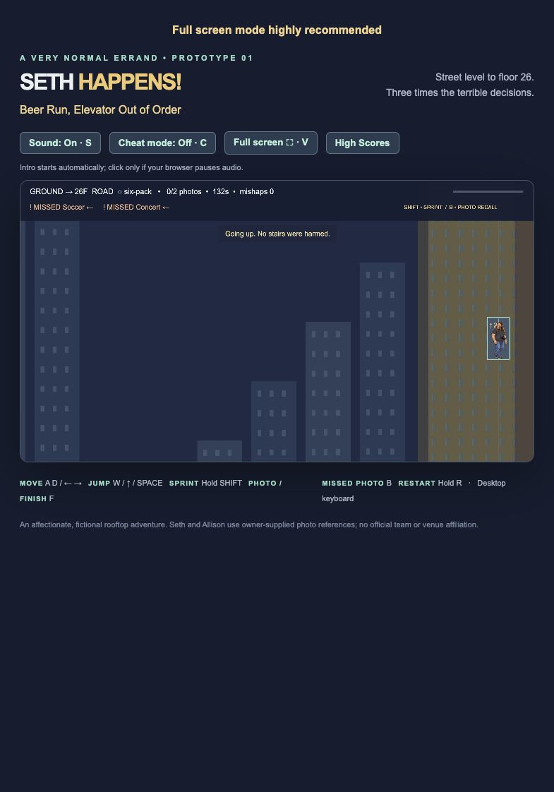

# Seth Happens - Beer Run, Elevator Out of Order


**[Play in your browser](https://natsteff.github.io/seth-happens/)** · Fullscreen highly recommended.

One six-pack. Two photos. Twenty-six floors. Get Seth home to Allison, Oakey and Ellowyn before the three-minute deadline.

## Controls

| Action | Key |
| --- | --- |
| Move | A / D or ← / → |
| Jump | Space, W or ↑; hold for height, tap for a short hop |
| Sprint | Hold Shift |
| Photo / finish / enter elevator | F |
| Return to a missed photo | B |
| Sound | S |
| Fullscreen | V or fullscreen button; Esc exits |
| Jump clues | C |
| Restart | Hold R |

Floor 01 is the first rooftop. Only its drop to the road is safe. Falling from any higher floor screams, costs one fall penalty, and retries that rooftop. The road stays open beneath the route.

Rolling and walking obstacles patrol the whole floor. Pianos, anvils, window AC units and beer coolers drop at distinct intervals in the middle of their platforms. Watch their warning and aftermath, then choose your jump.

## Scoring and records

- Finish within **180 seconds**: 1,000 base points.
- Each photo: +250; photos first recovered after reaching floor 26: +125.
- Deliver the six-pack: +500.
- Each fall, squish or bump: −10, counting each incident once.
- Finish under **120 seconds**: +100 for each whole second saved. A 90-second finish earns +3,000. Fractional seconds round up before calculating the bonus.
- At 180 seconds, the run fails and no score is saved.
- Intro and high-score dialogs pause the clock; ordinary play, photo recovery and the elevator journey use time.

Names and scores stay in that browser, including earlier versions’ records. The top 10 and full history show dates, times, objectives and mishaps. Clearing requires the configured password and confirmation. The browser stores a password verifier, not the readable password; this deters casual clearing but is not server authentication. Browser storage can be cleared independently.

<details>
<summary>Roadside Easter egg</summary>

At the far end of the bottom road, jump the guitar and amp, then kick the ball into the goal. Enter the revealed elevator with F. The ride goes straight up the ghosted tower, arriving as the elevator audio ends.

Taking this shortcut gives a fixed **−10,000** score with **CHEATER** added to the displayed name, regardless of bonuses. Only the first five shortcut entries are retained, in achievement order beneath all legitimate scores.

</details>

## Screenshots




## Local development

Node 22.12+ and pnpm 11.25.0:

```sh
pnpm install
pnpm dev
pnpm test
pnpm build
```

The repository uses relative asset URLs for GitHub Pages. Source is on main; the compiled playable site is on gh-pages. No backend, accounts, analytics or shared scoreboard.

Owner-supplied character references, logo and audio; generated character artwork and original code-drawn props/effects. The Minnesota United crest is owner supplied for an unofficial fan scene; no affiliation or endorsement. Raw reference photographs are not included. See [asset and dependency notices](THIRD_PARTY_NOTICES.md).
