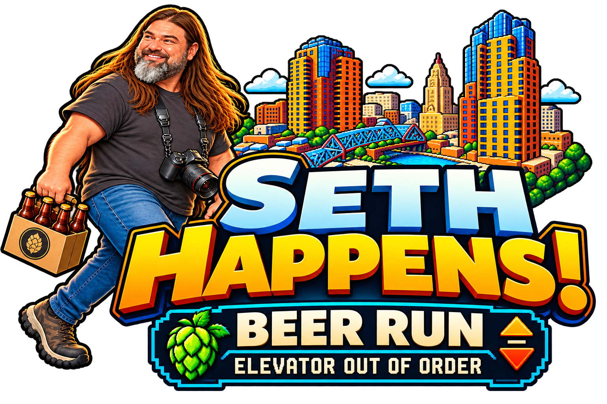
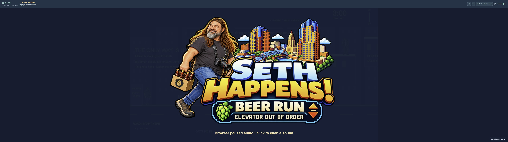
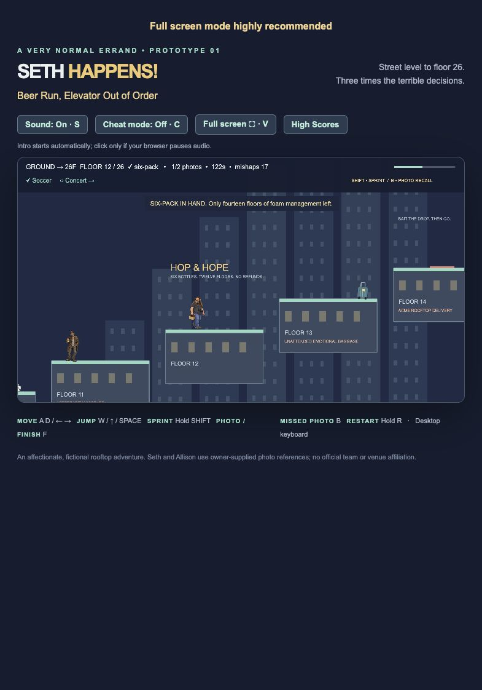
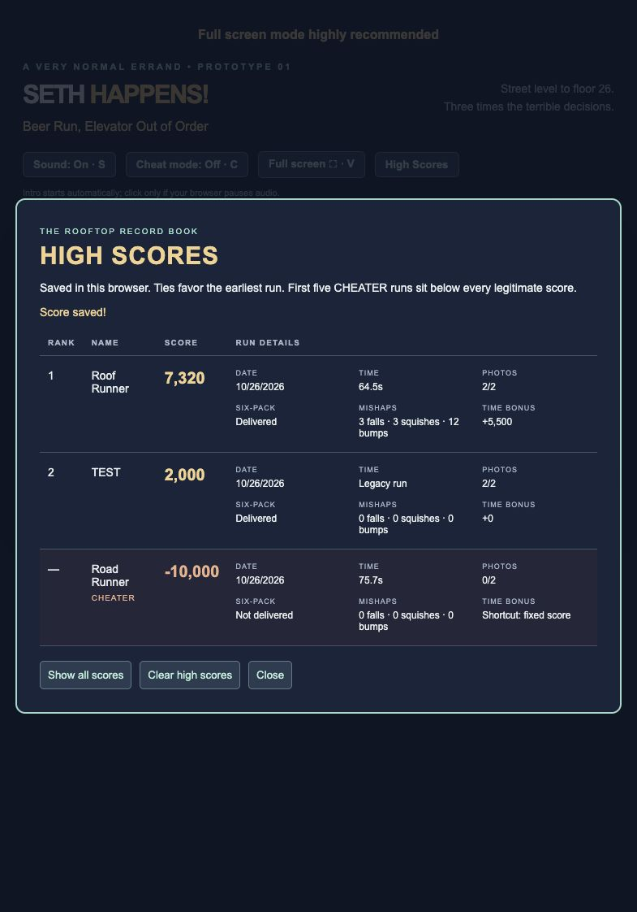

# Seth Happens - Beer Run, Elevator Out of Order



<p align="center">
  <a href="https://natsteff.github.io/seth-happens/"></a>
</p>

Fullscreen highly recommended. **Play Now on GitHub Pages uses local browser high scores only. Server-wide high scores cannot run on GitHub Pages; they require a server-enabled installation.**

One six-pack. Two photos. Twenty-six floors. Get Seth home to Allison, Oakey and Ellowyn before the three-minute deadline. See if you can find the 'easter egg'!

## Controls

| Action | Key |
| --- | --- |
| Move | A / D or ← / → |
| Jump | Space, W or ↑ jumps immediately; press twice within 0.3s for Mega Jump. Holding has no extra effect |
| Sprint | Hold Shift |
| Pause / resume | P or Pause button |
| Photo / finish | F |
| Return to a missed photo | B |
| Sound | S |
| Fullscreen | V or fullscreen button; Esc exits |
| Jump clues | C |
| Restart | Hold R |

Floor 01 is the first rooftop. Returning to a lower rooftop is safe. Missing the rooftops and falling toward the road from Floor 02 or higher screams, costs one fall penalty, and retries the last rooftop. Dropping from Floor 01 to the road remains safe.

Rolling and walking obstacles patrol the whole floor. Pianos, anvils, window AC units and beer coolers drop at distinct intervals in the middle of their platforms. Watch their warning and aftermath, then choose your jump.

## Scoring and records

- Finish within **180 seconds**: 1,000 base points.
- Each photo: +250; photos first recovered after reaching floor 26: +125.
- Deliver the six-pack: +500.
- Each fall, squish or bump: −10, counting each incident once.
- Finish under **120 seconds**: +100 for each whole second saved. A 90-second finish earns +3,000. Fractional seconds round up before calculating the bonus.
- At 180 seconds, the run fails and no score is saved.
- Intro and high-score dialogs pause the clock. P pauses gameplay, countdown, animations and audio. Resume continues from the same point.

## New in version 0.2.2: optional server high scores

High Scores opens your existing local browser list directly by default, including on the **Play Now** GitHub Pages version. Server scores default off in `public/game-config.json` (deployed as `game-config.json`).

Server installations can enable **Server High Scores** alongside **This PC High Scores**. New runs attempt both lists, with separate save results. Existing local records automatically sync to that deployment’s server when enabled, without deleting local scores or duplicating imports. Failed syncs retry when reopening scores or reconnecting. Older untimed runs retain their original score and date without an invented timer bonus. Each hosted copy has its own shared records.

Server-wide scores require a running score service; GitHub Pages cannot provide it. See [server setup](docs/leaderboard-server.md). Clearing acts on the selected list only and requires its password and confirmation.


## Screenshots





## Local development

Node 22.12+ and pnpm 11.25.0:

```sh
pnpm install
pnpm dev
pnpm test
pnpm build
```

The repository uses relative asset URLs for GitHub Pages. Source is on main; the compiled playable site is on gh-pages. The shared leaderboard requires the server setup above; GitHub Pages hosts only the game files. No player accounts or analytics.

Owner-supplied character references, logo and audio; generated character artwork and original code-drawn props/effects. The Minnesota United crest is owner supplied for an unofficial fan scene; no affiliation or endorsement. Raw reference photographs are not included. See [asset and dependency notices](THIRD_PARTY_NOTICES.md).
