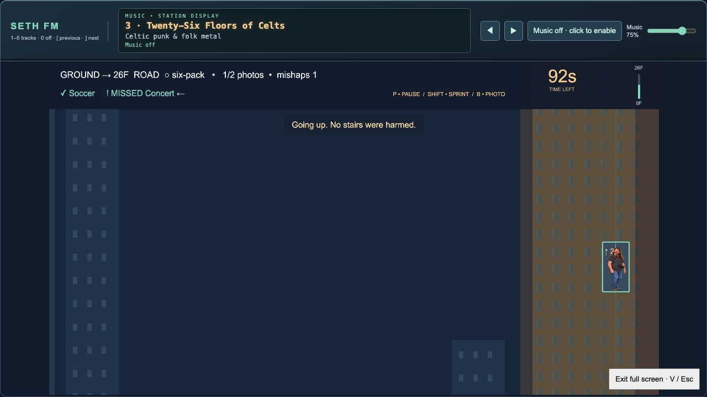
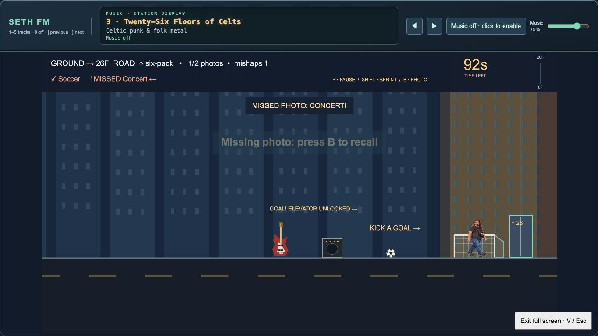
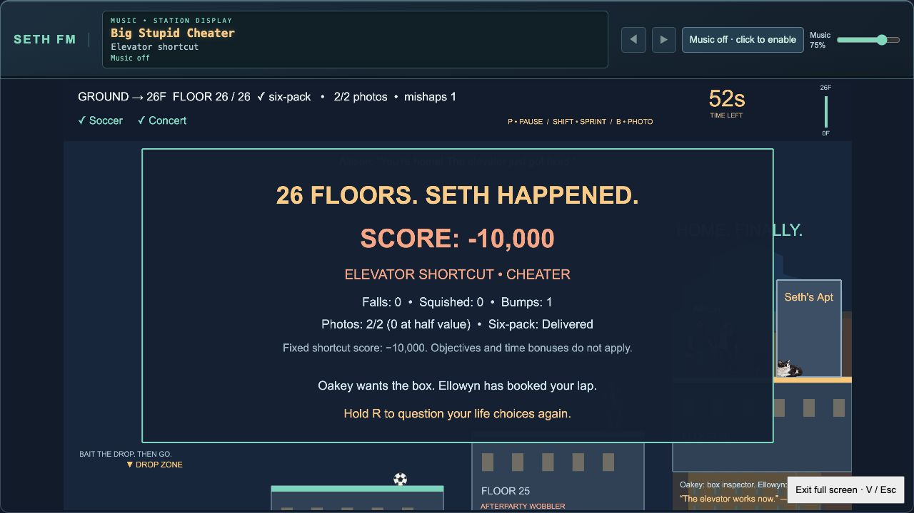

# Roadside Easter egg

At the far end of the bottom road, jump the guitar and amp, then kick the ball into the goal. Enter the revealed elevator with F. The ride goes straight up the ghosted tower, arriving as the elevator audio ends.

Taking this shortcut gives a fixed **−10,000** score with **CHEATER** added to the displayed name, regardless of bonuses. Only the first five shortcut entries are retained, in achievement order beneath all legitimate scores.

Current v0.3.12 desktop captures; scenes staged for documentation, with no scores submitted.

